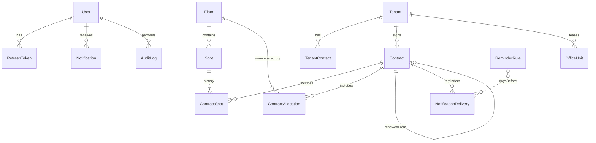

# Database schema

Source of truth: [`prisma/schema.prisma`](../prisma/schema.prisma).

| Table | Purpose |
|---|---|
| `User` | System users, with role `ADMIN`, `OWNER` or `STAFF`, plus locale and reminder opt-in |
| `RefreshToken` | Rotating refresh tokens (stored as a sha256 hash) |
| `Floor` | `B2 B1 GF MF 1F 2F YARD SHADED`: name, level, SVG plan, viewBox, official capacity |
| `Spot` | A parking spot. `label` is unique per floor; `geometry` is the polygon on the plan, or null if not placed; `isActive` marks out of service |
| `Tenant` / `TenantContact` | Offices (default `minSpots` = 2) and their contacts (email / phone / WhatsApp / reminders) |
| `OfficeUnit` | Building units from Sheet4, with parking entitlement by area |
| `Contract` | Annual contract: number, dates, status (`DRAFT ACTIVE RENEWED EXPIRED TERMINATED`), amount, `needsReview`, renewal chain |
| `ContractSpot` | Numbered spot in a contract (`INCLUDED` or `PAID`, plus price). This is also each spot's history |
| `ContractAllocation` | Unnumbered quantity on a floor (open yard) |
| `ReminderRule` | `daysBefore`, channels, notify owner / tenant |
| `Notification` | In-app notifications per user |
| `NotificationDelivery` | Every outbound attempt; a unique `dedupeKey` makes the reminder job idempotent |
| `AppSetting` | Tariff, expiring threshold, minimum spots, owner emails, contract prefix |
| `ImportBatch` | Excel import preview, issues and commit history |
| `AuditLog` | Who did what, and when |

A spot's **status is derived from contracts** and is never stored:
- `INACTIVE` when `isActive = false`.
- `RENTED` or `EXPIRING` when there is an `ACTIVE` contract. It becomes `EXPIRING` when the end date is within the threshold (default 60 days).
- `EXPIRED` when the latest contract has expired and was not renewed.
- `AVAILABLE` otherwise.
